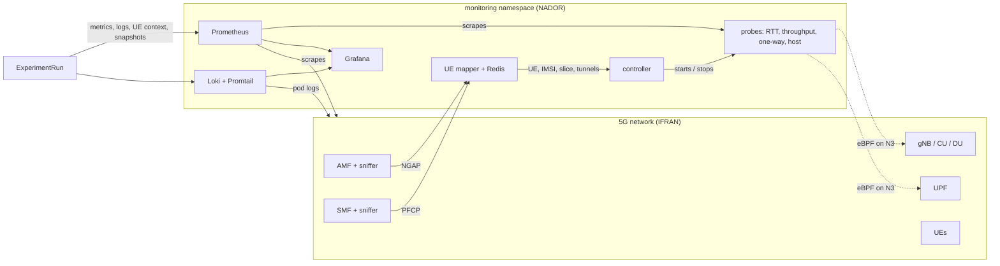

# How it works

NADOR runs next to a 5G network that IFRAN deployed. IFRAN creates the core, the RAN and the
UEs; NADOR adds a monitoring stack beside them, attaches to the network functions it should
watch, and saves what it observed during each experiment.

## The pieces

- **Prometheus, Grafana, Loki and Promtail** are installed with their usual Helm charts. Loki and
  Promtail only when a `logs` metric is on.
- **Sniffers** are attached to the AMF and the SMF as ephemeral containers. They read NGAP and
  PFCP, so NADOR learns each session as it is set up: which UE (IMSI) has which IP address,
  slice and GTP tunnels (TEIDs). This is why monitoring is deployed **after the RAN and before the
  UEs attach**: a UE attached earlier is only seen once it reattaches.
- **The UE mapper** (with Redis) turns the sniffed messages into an up-to-date table of UEs and
  serves it to the controller and to experiments.
- **The controller** starts and stops probes. For `rtt`, `throughput`, the one-way metrics and
  `user_plane_paths` it creates probe pods on the nodes running the gNBs and UPFs, scoped to the
  UEs the mapper knows. For the host probes it pauses and resumes their DaemonSets. It reads its
  settings from the `nador-controller-settings` ConfigMap every few seconds, so a change made with
  `start`/`stop` applies without redeploying.
- **Probes** measure with eBPF on the N3 interface (GTP-U between gNB and UPF), or on the hosts.

## How Prometheus finds targets

Prometheus asks the Kubernetes API what runs in the monitored namespaces and keeps what is
annotated `prometheus.io/scrape: "true"` (with `prometheus.io/port` and `prometheus.io/path`):

- **Network functions**: for each target with a `metrics_port`, NADOR creates a Service named
  `metrics-<category>-<component>` carrying those annotations, so the core and RAN images need no
  changes.
- **NADOR's own pods** (probes, the UE mapper, the KPI collectors) annotate themselves, so a probe
  the controller starts later is scraped without any redeploy.
- **The sniffers** are scraped pod by pod through `sniffer-<kind>-<category>-<component>`
  Services, so several AMF replicas give one series each.
- kube-prometheus-stack also scrapes the kubelet, kube-state-metrics and, with `node_metrics`,
  node-exporter.

Relabelling adds the `namespace`, `pod`, `service` and `node` labels that queries filter on.

## How logs reach Loki

Promtail runs on every node, reads the container log files under `/var/log/pods`, labels each
line with its `namespace`, `pod` and `container`, and pushes it to Loki. It keeps only the
namespaces whose `logs` metric is on: the RAN's (`metrics.ran.logs`), the core's
(`metrics.core.logs`, including the sniffers) and NADOR's own (`metrics.host.logs`).

## What gets deployed

`monitoring.plan()` shows the Helm releases and their values without touching the cluster;
`monitoring.deploy()` installs them, then attaches the sniffers. Every container image is pinned by
digest in `src/nador/assets/images.json`; a profile's `images:` section overrides individual
entries.
